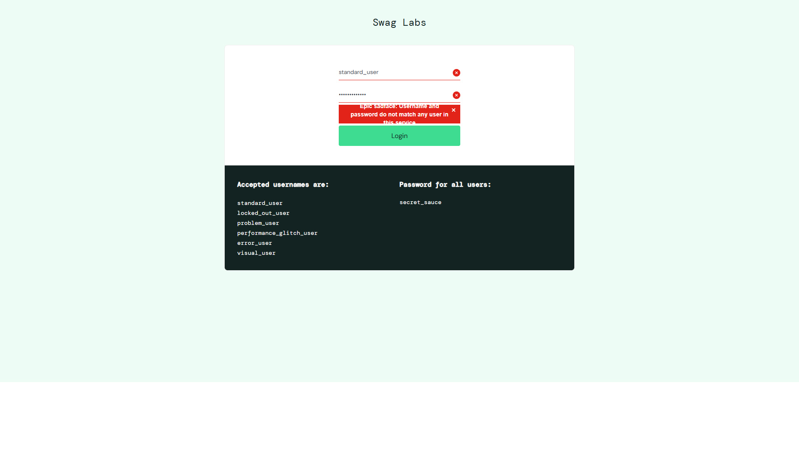
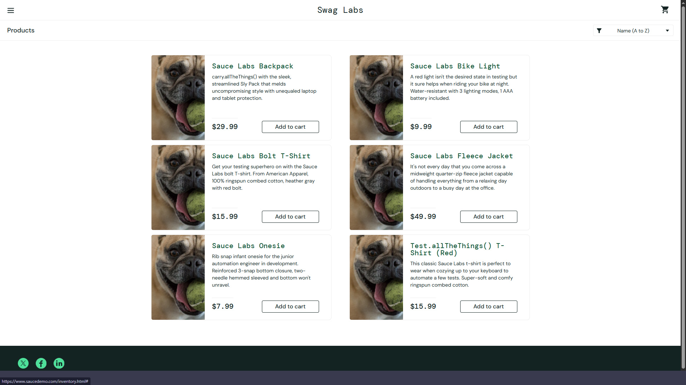

# Task 1 — Тестирование SauceDemo и использование ИИ

## 1. Тест-кейсы

### 1.1. Позитивный тест-кейс

| ID | Заголовок | Описание | Предусловия | Окружение | Шаги | Ожидаемый результат | Фактический | Статус | Исполнитель |
|---|---|---|---|---|---|---|---|---|---|
| SC-SAUCE-01 | Авторизация на saucedemo.com: standard_user / secret_sauce, успешный вход | Вход на saucedemo.com с валидными данными standard_user / secret_sauce и переход на страницу Products | `https://www.saucedemo.com/` доступен; открыта страница авторизации (Login). Пользователь не авторизован (нет активной сессии); известны валидные учётные данные `standard_user` / `secret_sauce` | Windows 10/11 (ноутбук); Chrome 127+; 1366×768; Язык RU; Сеть стабильна; Расширения нет | 1. Открыть `https://www.saucedemo.com/`.<br>2. В поле Username ввести `standard_user`.<br>3. В поле Password ввести `secret_sauce`.<br>4. Нажать кнопку Login.<br>5. Проверить переход на `/inventory.html`.<br>6. Проверить заголовок страницы — Products.<br>7. Проверить список товаров (6 карточек).<br>8. Проверить иконку корзины (пуста).<br>9. Проверить отсутствие сообщений об ошибке. | 1. Страница логина открыта, поля доступны.<br>2. В поле Username отображается `standard_user`.<br>3. В поле Password символы скрыты точками.<br>4. Происходит переход на `/inventory.html`.<br>5. URL изменился на `https://www.saucedemo.com/inventory.html`.<br>6. Заголовок страницы — Products.<br>7. Виден список из 6 товаров с названиями, ценами и кнопками Add to cart.<br>8. Иконка корзины присутствует, счётчик пуст.<br>9. Красных сообщений об ошибке нет. | Переход на `/inventory.html` выполнен, заголовок Products, 6 товаров, корзина пуста, ошибок нет | Passed | tristibl |

### 1.2. Негативные тест-кейсы

| ID | Заголовок | Описание | Предусловия | Окружение | Шаги | Ожидаемый результат | Фактический | Статус | Исполнитель |
|---|---|---|---|---|---|---|---|---|---|
| SC-SAUCE-03 | Авторизация на saucedemo.com: standard_user / неверный пароль, отказ во входе | Отказ на входе на saucedemo.com при корректном логине `standard_user` и неверном пароле `secret_sauce1`: отображение сообщения об ошибке | `https://www.saucedemo.com/` доступен; открыта страница авторизации (Login). Пользователь не авторизован; известен валидный логин `standard_user`; для проверки используется неверный пароль `secret_sauce1` | Windows 10/11 (ноутбук); Chrome 127+; 1366×768; Язык RU; Сеть стабильна; Расширения нет | 1. Открыть `https://www.saucedemo.com/`.<br>2. В поле Username ввести `standard_user`.<br>3. В поле Password ввести `secret_sauce1`.<br>4. Нажать кнопку Login.<br>5. Проверить, что перехода на `/inventory.html` не произошло.<br>6. Проверить сообщение об ошибке.<br>7. Проверить, что поля остаются доступными для редактирования. | 1. Страница логина открыта.<br>2. В поле Username отображается `standard_user`.<br>3. В поле Password символы скрыты точками.<br>4. Вход не выполняется — пользователь остаётся на странице логина.<br>5. URL остаётся `https://www.saucedemo.com/`.<br>6. Появляется красное сообщение `Epic sadface: Username and password do not match any user in this service`.<br>7. Поля остаются активными. | Появилось сообщение «Epic sadface: Username and password do not match any user in this service», перехода на `/inventory.html` нет, поля активны. | Passed | tristibl |
| SC-SAUCE-04 | Вход на saucedemo.com под заблокированным пользователем locked_out_user: отказ с сообщением «Sorry, this user has been locked out» | Проверка бизнес-логики блокировки учётной записи: при вводе валидных данных заблокированного пользователя `locked_out_user` / `secret_sauce` вход не выполняется и отображается сообщение о блокировке | `https://www.saucedemo.com/` доступен; открыта страница авторизации (Login). Пользователь не авторизован; известны учётные данные заблокированного пользователя `locked_out_user` / `secret_sauce` | Windows 10/11 (ноутбук); Chrome 127+; 1366×768; Язык RU; Сеть стабильна; Расширения нет | 1. Открыть `https://www.saucedemo.com/`.<br>2. В поле Username ввести `locked_out_user`.<br>3. В поле Password ввести `secret_sauce`.<br>4. Нажать кнопку Login.<br>5. Проверить, что перехода на `/inventory.html` не произошло.<br>6. Проверить сообщение об ошибке.<br>7. Проверить, что поля остаются доступными для редактирования. | 1. Страница логина открыта.<br>2. В поле Username отображается `locked_out_user`.<br>3. В поле Password символы скрыты точками.<br>4. Вход не выполняется — пользователь остаётся на странице логина.<br>5. URL остаётся `https://www.saucedemo.com/`.<br>6. Появляется красное сообщение `Epic sadface: Sorry, this user has been locked out`.<br>7. Поля остаются активными. | Появилось сообщение «Epic sadface: Sorry, this user has been locked out», перехода на `/inventory.html` нет, поля активны. | Passed | tristibl |
| SC-SAUCE-05 | Отображение изображений товаров на saucedemo.com: у всех товаров одинаковая картинка (problem_user) | Проверка соответствия изображения каждого товара его названию на странице Products. У пользователя `problem_user` проверяется, отображаются ли уникальные изображения для каждого товара. | `https://www.saucedemo.com/` доступен; открыта страница Products. Пользователь авторизован под `problem_user` (пароль `secret_sauce`); открыта страница Products со списком товаров. | Windows 10/11 (ноутбук); Chrome 127+; 1366×768; Язык RU; Сеть стабильна; Расширения нет | 1. На странице Products сравнить изображения всех 6 товаров с их названиями (Sauce Labs Backpack, Sauce Labs Bike Light и т.д.).<br>2. Сравнить изображения между карточками и убедиться, что они различаются. | 1. У каждого товара отображается своё уникальное изображение, соответствующее названию товара.<br>2. Изображения различаются между карточками. | 1. У всех 6 товаров отображается одна и та же картинка (собачка).<br>2. Уникальных изображений нет — изображение не соответствует названию товара. | Failed | tristibl |

---

## 2. Скриншоты процесса проверки

### 2.1. Позитивный сценарий — успешный вход


*На скриншоте видно: страница Products, список товаров, URL `saucedemo.com/inventory.html`, иконка корзины.*

### 2.2. Негативный — неверный пароль



*На скриншоте видно: поле Username с `standard_user`, пароль точками, красное сообщение `Username and password do not match any user in this service`.*

### 2.3. Негативный — заблокированный пользователь


*На скриншоте видно: поле Username с `locked_out_user`, пароль точками, красное сообщение `Epic sadface: Sorry, this user has been locked out`.*

### 2.4. Негативный UI — одинаковые картинки (собачки)



*На скриншоте видно: страница Products под `problem_user`, несколько карточек с одинаковой картинкой (собачка) и разными названиями товаров.*

---

## 3. Использование ИИ для генерации тест-кейса

### 3.1. Какой тест-кейс сгенерирован с помощью ИИ

Негативный UI/контентный тест-кейс **SC-SAUCE-05** — «Отображение изображений товаров на saucedemo.com: у всех товаров одинаковая картинка (problem_user)».

### 3.2. Использованный промпт

```
Выступай в роли тестировщика. Нужно подготовить негативный тест-кейс для учебного магазина https://www.saucedemo.com/.

Проверяем страницу Products под учётной записью problem_user (пароль secret_sauce). Особенность этой учётки в том, что вместо уникальных фото товаров у всех карточек отображается одна и та же картинка (собачка).

Оформи результат таблицей с колонками:
ID | Название кейса | Суть проверки | Что должно быть до начала | Условия стенда | Ход выполнения | Ожидаемое поведение | Полученный результат | Вердикт | Кто выполнял | Примечания

Пожелания к оформлению:
- название кейса строй по схеме «что проверяем — где — при каких условиях»;
- действия пронумеруй;
- ожидаемые результаты пронумеруй в том же порядке, что и действия;
- заполни абсолютно все колонки, включая полученный результат и вердикт.
```


### 3.3. Черновик, который выдал ИИ

| Поле | Значение |
|---|---|
| ID | TC-001 |
| Название кейса | Отображение уникальных фото товаров — на странице Products — при входе под problem_user |
| Суть проверки | Проверка отображения уникальных фото для каждого товара вместо общей заглушки |
| Что должно быть до начала | 1. Пользователь не авторизован. 2. Открыта страница https://saucedemo.com. |
| Условия стенда | ОС: Windows 11; Браузер: Chrome (актуальный); Экран: 1920x1080; Кэш очищен |
| Ход выполнения | 1. Ввести в Username: problem_user.<br>2. Ввести в Password: secret_sauce.<br>3. Нажать Login.<br>4. Осмотреть фото всех товаров на странице Products. |
| Ожидаемое поведение | 1. Логин отображается в поле.<br>2. Пароль скрыт маской.<br>3. Выполнен переход на страницу Products.<br>4. У каждого товара загружено уникальное фото, соответствующее его названию и описанию. |
| Полученный результат | 1. Логин введён.<br>2. Пароль скрыт маской.<br>3. Открыта страница Products.<br>4. Во всех 6 карточках отображается одно фото (собака sl-404.168b1cce.jpg). |
| Вердикт | Failed |
| Кто выполнял | QA Engineer |
| Примечания | Баг воспроизводится в 100% случаев только под problem_user (под standard_user фото корректны). |


### 3.4. Анализ результата ИИ

| Критерий | Что выдал ИИ | Оценка |
|---|---|---|
| Все поля заполнены | Все поля заполнены, включая полученный результат, вердикт и примечания | ✅ |
| Название по схеме «что — где — при каких условиях» | «Отображение уникальных фото товаров — на странице Products — при входе под problem_user» — схема соблюдена | ✅ |
| Лишние шаги | Лишних шагов нет | ✅ |
| Пропущенные шаги | Шаг «перейти на сайт» вынесен в предусловия («Открыта страница https://saucedemo.com») — допустимо, не пропуск | ✅ |
| Согласованность ожидаемого/фактического | Согласованы по пунктам (4 против 4) | ✅ |
| Вердикт | `Failed` — логичен | ✅ |
| Качество формулировок | Предусловия краткие, но достаточные; исполнитель — роль (`QA Engineer`), а не имя; не указаны язык и стабильность сети | ⚠️ |

**Вывод:** другой ИИ выдал качественный черновик в табличном формате — все поля заполнены, название соответствует схеме «что — где — при каких условиях», шаги логичны и согласованы с ожидаемыми результатами (4 против 4), вердикт корректен. Недочёты косметические: исполнитель указан как роль, а не имя; окружение неполное (нет языка, стабильности сети, расширений).

### 3.5. Внесённые правки

- **ID** изменён с `TC-001` на `SC-SAUCE-05` — для единообразия с остальными кейсами файла.
- **Формат** приведён к единому табличному виду, как в разделах 1.1–1.2 (колонки ID | Заголовок | Описание | Предусловия | Окружение | Шаги | Ожидаемый результат | Фактический | Статус | Исполнитель).
- **Предусловия** дополнены: авторизация под `problem_user`, открыта страница Products.
- **Окружение** конкретизировано: ОС, браузер, разрешение, язык, сеть, расширения.
- **Исполнитель** заменён с роли `QA Engineer` на конкретное имя `tristibl`.
- **Фактический результат** упрощён: вместо «1. Логин введён…» — компактное описание дефекта.
- **Описание** слегка уточнено, чтобы не спойлерить дефект.

### 3.6. Финальная версия тест-кейса

| ID | Заголовок | Описание | Предусловия | Окружение | Шаги | Ожидаемый результат | Фактический | Статус | Исполнитель |
|---|---|---|---|---|---|---|---|---|---|
| SC-SAUCE-05 | Отображение изображений товаров на saucedemo.com: у всех товаров одинаковая картинка (problem_user) | Проверка соответствия изображения каждого товара его названию у `problem_user` | `https://www.saucedemo.com/` доступен; открыта страница Products. Пользователь авторизован под `problem_user` (`secret_sauce`) | Windows 10/11 (ноутбук); Chrome 127+; 1366×768; Язык RU; Сеть стабильна; Расширения нет | 1. На странице Products сравнить изображения всех 6 товаров с их названиями.<br>2. Сравнить изображения между карточками. | 1. У каждого товара своё уникальное изображение.<br>2. Изображения различаются. | 1. У всех 6 товаров одна и та же картинка (собачка).<br>2. Уникальных изображений нет. | Failed | tristibl |