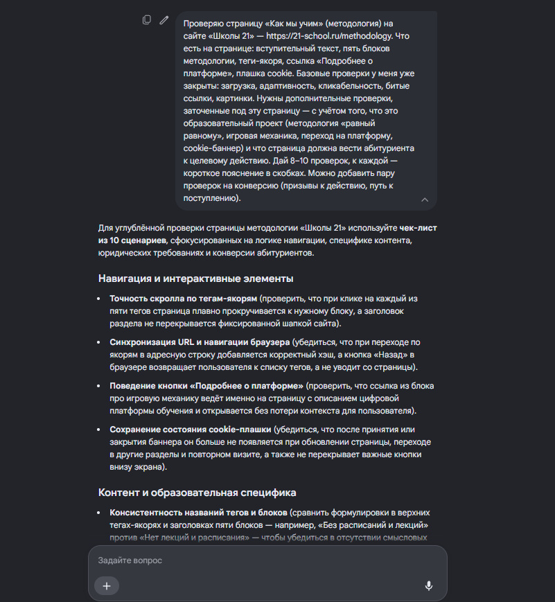

# Задание 2. Чек-лист раздела «Как мы учим» (https://21-school.ru/methodology)

## Часть 1. Самостоятельный чек-лист (минимум 5 проверок)

1. Раздел открывается по прямой ссылке: страница загружается полностью, без ошибок и пустого экрана (проверка доступности и корректной отрисовки).
2. При изменении ширины окна браузера вёрстка сохраняет структуру и не «разъезжается» (проверка адаптивности на разных разрешениях).
3. Интерактивные элементы страницы (кнопки, ссылки-действия) откликаются на клик и выполняют заявленное действие (проверка работоспособности интерактива).
4. Внутренние ссылки раздела ведут на реально существующие страницы, битых переходов нет (проверка целостности навигации).
5. Все изображения и иконки на странице отображаются корректно, битых картинок нет (проверка графических элементов).

---

## Часть 2. Расширение чек-листа с помощью ИИ

### Промпт к нейросети

> Проверяю страницу «Как мы учим» (методология) на сайте «Школы 21» — https://21-school.ru/methodology.
> Что есть на странице: вступительный текст, пять блоков методологии, теги-якоря, ссылка «Подробнее о платформе», плашка cookie.
> Базовые проверки у меня уже закрыты: загрузка, адаптивность, кликабельность, битые ссылки, картинки.
> Нужны дополнительные проверки, заточенные под эту страницу — с учётом того, что это образовательный проект (методология «равный равному», игровая механика, переход на платформу, cookie-баннер) и что страница должна вести абитуриента к целевому действию.
> Дай 8–10 проверок, к каждой — короткое пояснение в скобках. Можно добавить пару проверок на конверсию (призывы к действию, путь к поступлению).

### Ответ ИИ (сгенерированные дополнительные проверки)

**Навигация и интерактив**

1. Точность перехода по тегам-якорям: при клике на каждый из пяти тегов страница плавно прокручивается к нужному блоку, заголовок не перекрывается фиксированной шапкой (пользователь должен сразу видеть начало раздела).
2. Синхронизация якорей с адресной строкой: при переходе по тегу в URL добавляется корректный хэш, а кнопка «Назад» возвращает к списку тегов, а не уводит со страницы (предсказуемая навигация).
3. Поведение ссылки «Подробнее о платформе»: переход ведёт именно на страницу с описанием цифровой платформы обучения и не теряет контекст (ключевой путь к изучению платформы).
4. Сохранение состояния cookie-плашки: после принятия или закрытия баннер не появляется при обновлении, переходе в другие разделы и повторном визите, а также не перекрывает важные кнопки внизу экрана (чистый UX).

**Контент и образовательная специфика**

5. Консистентность названий тегов и блоков: формулировки в тегах-якорях и заголовках пяти блоков совпадают по смыслу (например, «Без расписаний и лекций» против «Нет лекций и расписания» — расхождений быть не должно).
6. Понятность терминологии для новичков: внутренние термины вроде «трайбов», «равный равному» и «хакатонов» раскрыты достаточно ясно для абитуриента без ИТ-бэкграунда.
7. Актуальность условий поступления: возрастной порог «от 18 лет» и статус бесплатного обучения соответствуют правилам приёма текущего года (исключение юридических и репутационных рисков).

**Конверсия и путь абитуриента**

8. Наличие и видимость целевого действия (CTA) в финале: после пятого блока «Рост навыков» есть прямой призыв подать заявку или перейти на страницу «Как поступить» (заинтересованный пользователь не упирается в пустой футер).
9. Непрерывность воронки до заявки: путь от чтения методологии через меню «Поступающим» или кнопку «Войти» до формы регистрации на отборочный этап не содержит тупиков и лишних шагов.
10. Передача UTM-меток при переходе к поступлению: при переходе со страницы методологии на страницу подачи заявки или авторизации аналитические параметры источника трафика сохраняются.

### Выбранные 2–3 проверки и обоснование

Из списка ИИ выбраны **3 наиболее релевантные** для данного раздела:

- **Точность перехода по тегам-якорям (п. 1)** — теги-якоря есть прямо на странице и служат навигацией по методологии; если клик не прокручивает к блоку или заголовок перекрыт шапкой, пользователь не может быстро перейти к нужному разделу. Проверка специфична именно для этой страницы.
- **Сохранение состояния cookie-плашки (п. 4)** — плашка cookie реально отображается при первом заходе (проверено в инкогнито); если после согласия она возвращается или перекрывает кнопки, это мешает чтению раздела и снижает конверсию.
- **Наличие и видимость CTA в финале (п. 8)** — страница методологии должна вести абитуриента к целевому действию; если после пятого блока нет призыва подать заявку, заинтересованный пользователь упирается в пустой футер и уходит. Критично для лендинга.

Остальные проверки (синхронизация URL, ссылка на платформу, консистентность тегов, терминология, условия поступления, воронка, UTM) — полезные, но либо относятся к общим элементам сайта, либо требуют доступа к аналитике/DevTools, либо не отражают специфику именно раздела «Как мы учим», поэтому в итоговый чек-лист не вошли.

### Скриншот промпта

---

## Часть 3. Итоговый чек-лист (5 базовых + 3 добавленные)

1. Раздел открывается по прямой ссылке: страница загружается полностью, без ошибок и пустого экрана (проверка доступности и корректной отрисовки).
2. При изменении ширины окна браузера вёрстка сохраняет структуру и не «разъезжается» (проверка адаптивности на разных разрешениях).
3. Интерактивные элементы страницы (кнопки, ссылки-действия) откликаются на клик и выполняют заявленное действие (проверка работоспособности интерактива).
4. Внутренние ссылки раздела ведут на реально существующие страницы, битых переходов нет (проверка целостности навигации).
5. Все изображения и иконки на странице отображаются корректно, битых картинок нет (проверка графических элементов).
6. Точность перехода по тегам-якорям: клик по каждому из пяти тегов плавно прокручивает страницу к нужному блоку, заголовок не перекрывается фиксированной шапкой (проверка навигации по методологии). — *добавлено по результатам ИИ*
7. Сохранение состояния cookie-плашки: после принятия или закрытия баннер не появляется при обновлении, переходе в другие разделы и повторном визите, не перекрывает важные кнопки внизу экрана (проверка сохранения статуса cookie). — *добавлено по результатам ИИ*
8. Наличие и видимость целевого действия (CTA) в финале: после пятого блока «Рост навыков» есть прямой призыв подать заявку или перейти на страницу «Как поступить» (проверка конверсии раздела). — *добавлено по результатам ИИ*

---

## Отчёт

**Что сделано:** составлен самостоятельный чек-лист из 5 проверок по разделу «Как мы учим»; затем с помощью нейросети сгенерированы 10 дополнительных проверок, специфичных для сайта; из них выбраны 3 наиболее релевантные и добавлены в итоговый чек-лист.

**Какие проверки добавлены:**
1. Точность перехода по тегам-якорям к соответствующим блокам методологии (без перекрытия заголовка шапкой).
2. Сохранение состояния cookie-плашки (баннер не возвращается после согласия и не перекрывает кнопки).
3. Наличие и видимость CTA в финале страницы (призыв подать заявку или перейти на «Как поступить»).

**Почему добавлены именно они:** эти три проверки отражают специфику именно раздела «Как мы учим» — навигацию по тегам-якорям, работу cookie-плашки, которая реально отображается при первом заходе, и конверсионный финал, который ведёт абитуриента к целевому действию. Остальные проверки из ответа ИИ (синхронизация URL, ссылка на платформу, консистентность тегов, терминология, условия поступления, воронка, UTM) относятся к общим элементам сайта, требуют DevTools/аналитики или не привязаны к особенностям данного раздела, поэтому в итоговый список не включены.

**Скриншот промпта:** приложен (см. файл `task2promt2.jpg`).