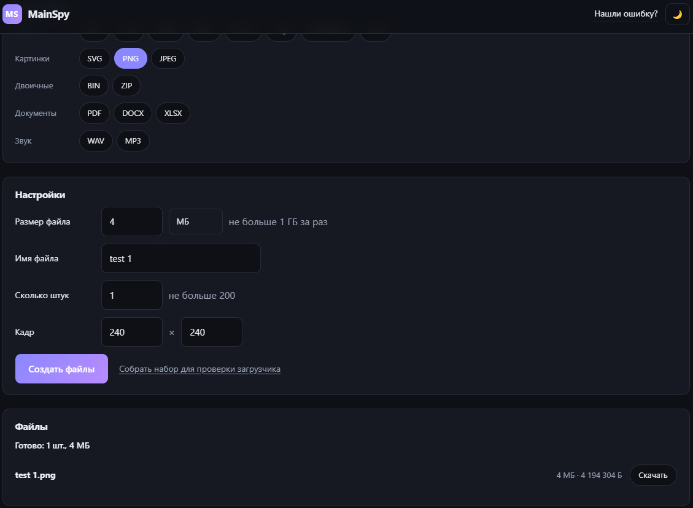
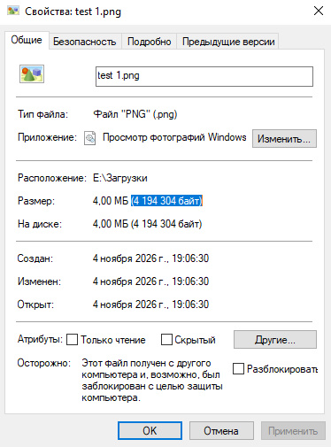
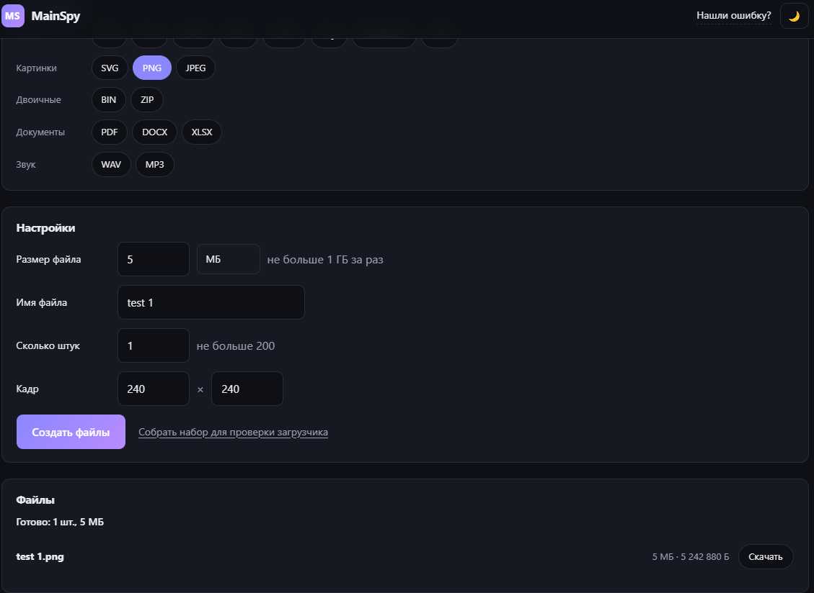
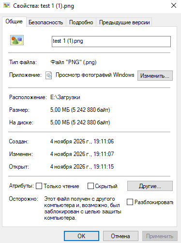
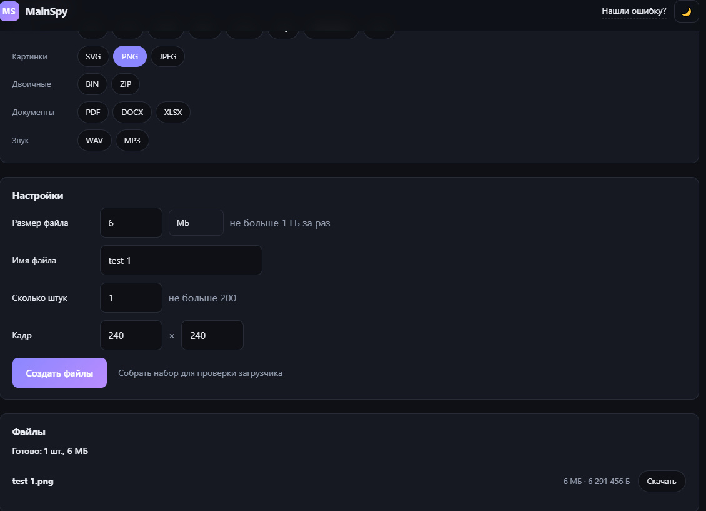
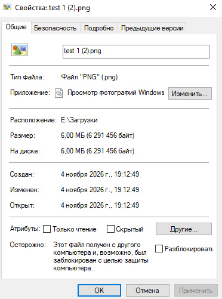
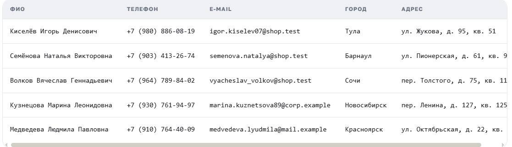

# Task 5. Генерация тестовых файлов и тестовых данных

## Часть 1. Ресурсы для генерации файлов различного размера

1. **MainSpy — Генератор файлов**  
   https://mainspy.ru/generator-fajlov

2. **QA Space — Генератор файлов**  
   https://qaspace.ru/instruments/generator-fajlov

Оба ресурса реально выполняют функцию генерации файлов заданного размера и подходят для проверки лимитов загрузки.

## Часть 2. Ресурсы для генерации тестовых данных

1. **Pawetta — Генератор тестовых данных**  
   https://pawetta.com/instrumenty/generator-testovyh-dannyh/

2. **Random Data Tools**  
   https://randomdatatools.ru/

Оба ресурса реально выполняют функцию генерации тестовых данных и подходят для заполнения форм.

---

## Часть 3. Тестовые файлы для проверки лимита «не более 5 МБ»

**Ресурс:** https://mainspy.ru/generator-fajlov  
**Допущение:** «5 МБ» = 5 × 1024 × 1024 = 5 242 880 байт.

| Имя файла | Размер | Тип теста | Ожидаемый результат |
|---|---|---|---|
| avatar_4mb.png | 4 МБ (4 194 304 байт) | Позитивный | Файл загружается ✅ |
| avatar_5mb.png | 5 МБ (5 242 880 байт) | Граничный | Файл загружается ✅ |
| avatar_6mb.png | 6 МБ (6 291 456 байт) | Негативный | Файл отклоняется ❌ |

### Файл 1 — avatar_4mb.png (позитивный тест)

**Скриншот строки в MainSpy (4 МБ · 4 194 304 Б):**

**Скриншот свойств файла в Windows (размер 4 194 304 байт):**

### Файл 2 — avatar_5mb.png (граничный тест)

**Скриншот строки в MainSpy (5 МБ · 5 242 880 Б):**

**Скриншот свойств файла в Windows (размер 5 242 880 байт):**

### Файл 3 — avatar_6mb.png (негативный тест)

**Скриншот строки в MainSpy (6 МБ · 6 291 456 Б):**

**Скриншот свойств файла в Windows (размер 6 291 456 байт):**

**Вывод по файлам:** позитивный (4 МБ) и граничный (5 МБ) файлы укладываются в лимит и должны загружаться. Негативный (6 МБ) превышает лимит и должен отклоняться. Проверка off-by-one выполнена: 5 242 880 байт — ровно на границе.

---

## Часть 4. Тестовые пользователи (Россия)

**Ресурс:** https://pawetta.com/instrumenty/generator-testovyh-dannyh/  
**Страна:** Россия (ресурс ориентирован на российские данные).

| # | ФИО | Телефон | Email | Город | Адрес |
|---|---|---|---|---|---|
| 1 | Киселёв Игорь Денисович | +7 (980) 886-08-19 | igor.kiselev07@shop.test | Тула | ул. Жукова, д. 95, кв. 51 |
| 2 | Семёнова Наталья Викторовна | +7 (903) 413-26-74 | semenova.natalya@shop.test | Барнаул | ул. Пионерская, д. 61, кв. 99 |
| 3 | Волков Вячеслав Геннадьевич | +7 (964) 789-84-02 | vyacheslav_volkov@shop.test | Сочи | пер. Толстого, д. 75, кв. 117 |
| 4 | Кузнецова Марина Леонидовна | +7 (930) 761-94-97 | marina.kuznetsova89@corp.example | Новосибирск | пер. Ленина, д. 127, кв. 125 |
| 5 | Медведева Людмила Павловна | +7 (910) 764-40-09 | medvedeva.lyudmila@mail.example | Красноярск | ул. Октябрьская, д. 22, кв. 127 |

**Скриншот таблицы из Pawetta (опционально):**

### Проверка телефонов (стандарт РФ: 11 цифр, +7, мобильный 9XX)

| # | Телефон | Соответствует? | Комментарий |
|---|---|---|---|
| 1 | +7 (980) 886-08-19 | ✅ Да | 11 цифр, +7, мобильный (980) |
| 2 | +7 (903) 413-26-74 | ✅ Да | 11 цифр, +7, мобильный (903) |
| 3 | +7 (964) 789-84-02 | ✅ Да | 11 цифр, +7, мобильный (964) |
| 4 | +7 (930) 761-94-97 | ✅ Да | 11 цифр, +7, мобильный (930) |
| 5 | +7 (910) 764-40-09 | ✅ Да | 11 цифр, +7, мобильный (910) |

**Вывод:** 5 из 5 телефонов соответствуют.

### Проверка адресов (формат РФ: город, ул./пер., д., кв.)

| # | Адрес | Соответствует? | Комментарий |
|---|---|---|---|
| 1 | Тула, ул. Жукова, д. 95, кв. 51 | ✅ Да | Корректная структура |
| 2 | Барнаул, ул. Пионерская, д. 61, кв. 99 | ✅ Да | Корректная структура |
| 3 | Сочи, пер. Толстого, д. 75, кв. 117 | ✅ Да | пер. — допустимое сокращение |
| 4 | Новосибирск, пер. Ленина, д. 127, кв. 125 | ✅ Да | Корректная структура |
| 5 | Красноярск, ул. Октябрьская, д. 22, кв. 127 | ✅ Да | Корректная структура |

**Вывод:** 5 из 5 адресов соответствуют.